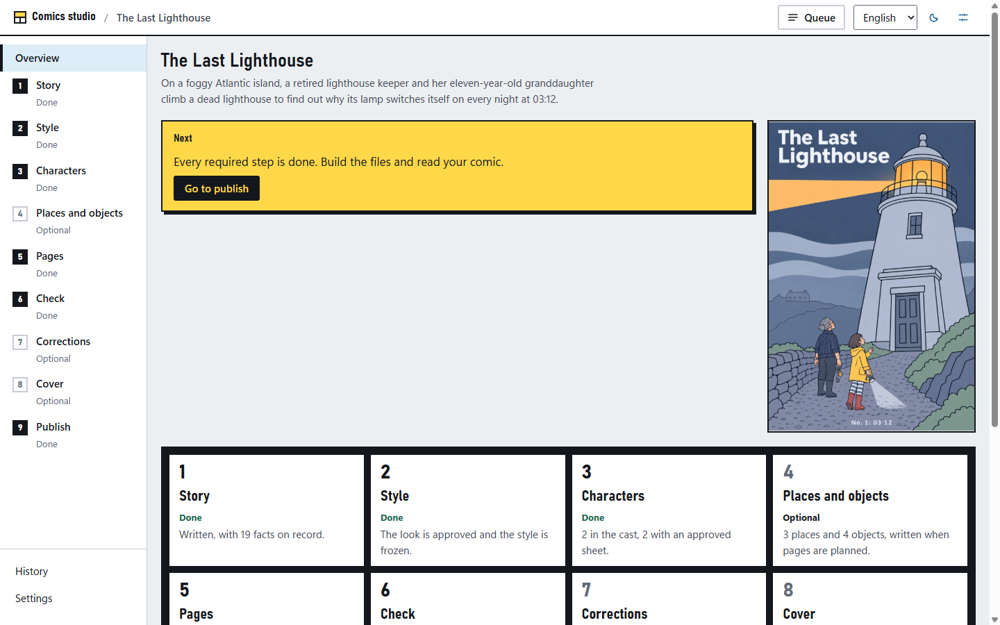
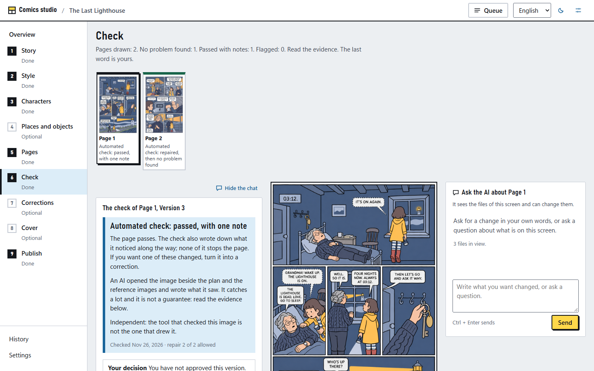

<div align="center">

# Everything AI Comics

### A workflow scaffold for AI-assisted comics.

### From source text to a published edition. Paged or webtoon. Multi-harness.

[](LICENSE)


Claude Code · Codex · Cursor · OpenCode

Pages are planned and audited before an image is requested.
Rendered pages are judged by looking at them.

</div>

---

There is no comic in this repository. It holds a scaffold: rules, agents,
commands, skills, and contexts that a coding assistant loads, and a set of
Node.js scripts that check what the assistant writes. You open a project in
Claude Code, Codex, Cursor, or OpenCode and run slash commands. The work
accumulates as YAML and Markdown in a `production/` workspace: canon, bibles,
page plans, prompt packages, reviews, editions.

People who would rather not work from an editor can use the
[web studio](#web-studio), a local app that drives the same scaffold from the
browser and writes the same files.

Image models draw a convincing single page. Across a sequence they swap one
character's face for another's and lose track of who is holding what. The
scaffold grew out of a manual pilot, a 12-page chapter that went through seven
editions, and each failure of that pilot became a file format or a check
here. The failure-to-mechanism table is in
[docs/plans/initial-scaffold-plan.md](docs/plans/initial-scaffold-plan.md).

## The pipeline at a glance

```
source text            story/source/
  → canon              /source-analyze, /story-bible      story/story-bible.yaml
  → series plan        /series-plan                       story/series-plan.yaml
  → bibles and style   /character-bible, /location-bible  characters/ locations/ props/
                       /prop-bible, /style-bible          style/style-block.txt
  → master references  /ingest-references                 references/manifest.yaml
                       /visual-development
  → issue breakdown    /issue-breakdown                   issues/<ISS_ID>/issue.yaml, scenes/
  → page plan          /page-plan                         pages/<PG_ID>/page.yaml
  → panel script       /panel-script                      page.yaml
  → ledger             /panel-ledger                      page.yaml, audited by check-continuity.js
  → reference plan     /reference-plan                    reference-plan.yaml
  → prompts            compile-prompts.js                 prompts/<provider>.yaml
  → generate           /generate-pages                    renders/<PG_ID>_V##.png, generations/
  → visual review      /visual-review                     reviews/<RENDER_ID>.review.yaml
  → repair             /repair-page                       the next _V##, with its own review
  → lettering          /lettering                         lettering.yaml, <RENDER_ID>.lettered.svg
  → cover (optional)   /cover                             cover/cover.yaml, cover/renders/CV_###_V##.png
  → continuity review  /continuity-review                 continuity/<ISS_ID>.final-state.yaml
  → edition            /build-edition                     editions/<ED_ID>/edition.yaml, exports/
```

`/smart-page` runs page plan through prompts for one scene in a single pass.
`/full-production` runs the whole list with an approval gate at the end of
each phase and a cost confirmation before each batch.

## Quickstart

You need Node.js 18 or later. There is nothing to install: the scripts use
Node built-ins only.

```bash
git clone https://github.com/MRCalderon3D/everything-ai-comics my-comic
cd my-comic
# open your assistant here (claude, codex, cursor, opencode) and run:
#   /project-init
```

The clone carries the generated wiring for every supported harness.
`/project-init` asks for the title, format, page size, color mode, lettering
mode, and provider in one batch, then creates the workspace. The repository's
`.gitignore` keeps `production/` and `production-*/` out of the scaffold's
history.

To create the workspace without an assistant:

```bash
npm run create:project -- --title "My Comic" --target .
```

That writes `./production/` with a `project.yaml`, the directory layout, and
starter files. Without `--target` the script creates `./my-comic/production/`.

For a project that lives in its own repository, install the scaffold into it:

```bash
node scripts/install.js --target ../my-comic --harness codex --profile full
```

`npm run doctor` reports the state of the generated wrappers and which
provider variables are set.

The commands a newcomer meets first:

| Command | What it does |
|---|---|
| `/project-init` | Creates the workspace and fixes format, page size, lettering mode, and provider in `project.yaml`. |
| `/source-analyze` | Breaks the source text into events, entities, and a fact registry. |
| `/story-bible` | Rules on open questions and records every fact as source, user change, or addition. |
| `/character-bible` | Writes each character's identity, distinguishing features, and wardrobe. |
| `/style-bible` | Writes the visual language and the frozen style block. |
| `/visual-development` | Generates the look page and the character sheets. The first step that can spend money. |
| `/smart-page` | Turns one scene into page layouts, panel script, ledger, reference plans, and prompts. |
| `/generate-pages` | Generates pages one at a time. Dry-run by default. |
| `/visual-review` | Reviews a rendered page against the plan and the references. |
| `/repair-page` | Repairs a flagged page as a sibling version. |
| `/cover` | Plans, generates, and reviews the issue's cover, and records the approved render. Optional. |
| `/build-edition` | Assembles reviewed pages and exports PDF, CBZ, a web reader, numbered images, and EPUB. |

The full walkthrough is [docs/getting-started.md](docs/getting-started.md).
Every command is listed in pipeline order in
[commands/README.md](commands/README.md).

## Web studio

The studio is a web app that runs on your own machine. You describe a comic,
pick a style, add characters, write what happens on each page, and get drawn
pages with a written check of each one. It has no dependencies to install:

```bash
npm run studio
```

That serves `http://127.0.0.1:4310` and opens the browser. The interface is
in English and Spanish.



The AI behind it is the command-line tools you are already signed in to.
Claude Code plans, writes, and reviews. Codex draws. No API key is involved,
and usage counts against those subscriptions. With only one of the two
installed the studio still works: without Codex you draw the pages elsewhere
and upload them, and without Claude Code, Codex does all three jobs and each
review is marked as not independent.

| Step | What you do |
|---|---|
| Story | Describe what the comic is about. The studio writes the story bible and the series plan, and you edit them. |
| Style | Pick a preset, describe a style, or upload reference images. Approve a look page, which freezes the style. |
| Characters | Add each character from a description, a photo, or both. Approve the drawn sheet: it becomes the face everything else is drawn from. Refine the full character sheet round by round. |
| Pages | Write what happens, on one page or several. Read the plan per page, then start the drawing queue. |
| Check | Read the verdict of each page with its evidence: what was expected and what is on the page. |
| Corrections | Mark a region or pick a panel, write the change, and compare the new version with the old one. |
| Cover | Optional. Describe it or let the AI propose one. |
| Publish | Build PDF, CBZ, EPUB, a web reader, or one image per page. |

Every step shows the text and the images of what is being made. You change
anything by editing it or by asking in the conversation docked beside every
screen. Each finished step is a commit in a local git repository inside the
project, so the History screen can take the project back to an earlier point.

The conversation can also do the work itself. Drop a photo into it and ask
for a character in the comic's style, ask for two more pages where she opens
the box, or for the cover. The reply proposes each step as a card that says
what it will do, which tool and model will do it, and how long it usually
takes, and nothing runs until you click Run or say yes. Approvals and
answers to a job's questions work the same way. When a job ends, the sheet,
the plan or the drawn page comes back into the conversation with a link to
the screen where you approve it. A question asked while a drawing runs is
answered at once, without waiting for it. A whole comic can be made from the
conversation alone, from the screens alone, or mixing both.

When an issue is finished, "New issue" on the Pages screen or the project
home starts the next one. It keeps the look, the characters, the places and
the story, and its first pages start from where the last issue ended.



A project made in the studio is an ordinary workspace. Open its folder in
your editor and the slash commands work on it, and the other way round.

A check is an AI reading the image next to the plan and the reference
sheets. It catches a lot and it is not a guarantee, so the studio always
shows the evidence and leaves the decision to you. Blocking problems are
repaired automatically, up to the project's repair limit. Smaller
observations are listed as notes, and any note can become a correction.

Timings from the first complete run with the real tools, a two-page comic
with a cover: the story took a minute and a half, the style two and a half,
each drawing two to five minutes, the plan for two pages eight minutes, and
a review under a minute.

Details are in [studio/README.md](studio/README.md). The HTTP API is in
[studio/docs/api.md](studio/docs/api.md), and the plan the studio was built
from, with the results of the three spikes, is in
[docs/plans/web-studio-plan.md](docs/plans/web-studio-plan.md).

## Repository model

The scaffold is organized in layers. Each has its own README.

- [`rules/`](rules/README.md): policy, what good work looks like. A common
  layer, the domain layers, and one format layer per project.
- [`agents/`](agents/README.md): roles, who owns the work.
- [`commands/`](commands/README.md): the slash commands, how work starts.
- [`skills/`](skills/README.md): procedures, how the work is done.
- `contexts/`: what matters in each phase (development, preproduction,
  production, publishing, review).
- [`schemas/`](schemas/README.md): a JSON Schema for every structured file in
  a workspace.
- `manifests/`: the machine-readable index that validation and the installer
  read.
- [`templates/`](templates/README.md): starter files for a new workspace,
  and a set of look presets.
- [`examples/`](examples/README.md): a complete sample workspace.
- `scripts/`: the tooling. Node.js 18 or later, CommonJS, no dependencies.
- [`providers/`](providers/README.md): adapters for image backends.
- [`hooks/`](hooks/README.md): checks that run when a file is written or a
  command is executed.
- `.claude/`, `.codex/`, `.cursor/`, `.opencode/`, `.agents/`: generated
  wrappers. Never edit them by hand.

The authoring contract is [docs/conventions.md](docs/conventions.md) (rosters,
file formats, IDs) together with [docs/data-model.md](docs/data-model.md) (the
shape of every workspace file).

## What makes comics different here

The long version, stage by stage, is [docs/workflow.md](docs/workflow.md).

### Plan before pixels

Pages, panels, positions, and the ledger are written before any prompt exists.
`build-reference-plan.js` exits with an error when a required master is
missing or unapproved. `compile-prompts.js` needs the style block and a
`reference-plan.yaml` next to the page. `/generate-pages` starts by running
the ledger audit and stops on the first error. An approved plan fixes intent.
It approves no image.

### The panel ledger

Every panel in `page.yaml` carries a row per character: position by level,
side, and landmark, wardrobe, state tags, and what they hold. Props in
nobody's hands get their own rows. A character who is out of frame keeps a
row, because leaving the frame resets nothing.

`check-continuity.js` walks the rows in reading order and reports:

| Code | What it catches |
|---|---|
| `POSITION_JUMP` | A character changes level inside a scene with no `moved` and no `ellipsis`. |
| `CUSTODY_JUMP` | A prop changes holder with no `transfers` entry. |
| `DOUBLE_CUSTODY` | A prop in two hands, or held and also placed. |
| `STATE_DROPPED` | A state tag such as a cut or a bloodstain disappears without `state_changes.resolves`. |
| `WARDROBE_JUMP` | An outfit changes inside a scene with no `wardrobe_change`. |
| `HANDS_OVERLOAD` | More than two hands in use. Carrying someone takes two, a prop takes its `hands_required`. |
| `DUPLICATE_CAST` | The same character twice in one panel. |
| `SPEAKER_ABSENT` | A balloon whose speaker has no row in the panel. |
| `LAYOUT_MISMATCH` | A reading order, tier count, or lettering order that does not add up. |
| `PAGE_CHAIN` | `enters_from` and `exits_to` that do not form one chain through the issue. |
| `UNKNOWN_REFERENCE` | A character, prop, location, wardrobe, level, or landmark the workspace does not define. |

The script exits 1 on any error. `validate-workspace.js` includes its
findings, and in Claude Code the `detect-continuity-drift` hook runs it after
every write to a `page.yaml`.

### One role per reference, and a frozen style block

Every image attached to a request has one role: `style`, `identity`,
`wardrobe`, `spatial_continuity`, `prop_consistency`, `composition`, or
`edit_target`. The schema of `reference-plan.yaml` allows nothing else. The
look master goes on every request with the role `style` and never stands in
for a face. Each character drawn on the page gets an identity sheet of their
own.

The style prompt lives in `style/style-block.txt` and is pasted verbatim into
every package. A package records the hash of the block and of the page it was
compiled from, and a live run refuses a package whose page or style block
changed afterwards.

### Reviews read the image

A returned file is a candidate. `/visual-review` opens it beside the plan
and the reference sheets, compares it with the neighboring pages, and fills
fourteen named checks: identity, cast count, position, movement, role and
causality, object identity, object custody, physical state, wardrobe,
spatial logic, drawing clarity, lettering, page structure, and style
fidelity. The schema requires every check, each with a non-empty evidence
string.

Two gates are recorded apart: style fidelity and narrative continuity. The
verdict is `pass`, `fixed`, or `flagged`. `validate-workspace.js` rejects a
`pass` that has findings, a `fixed` finding without a recheck against the new
render, and a blocking finding marked as accepted. Human approval is a
separate field on the review.

### Repairs are counted

A repair names the edit target, the failing panels, the exact changes, and
what must stay locked. It produces a sibling version. `repair_policy.max_cycles`
in `project.yaml` caps the attempts at 2 by default. `compile-prompts.js
--repair` refuses once the limit is reached, and `validate-workspace.js`
rejects a review whose `repair_cycle` exceeds it. After that, the plan or the
references are fixed before anything else is generated.

### Nothing is overwritten

Renders are named `<PG_ID>_V##` and `generate-assets.js` always writes the
next free version. An approved master is immutable: a change is a new `_V##`.
`build-edition.js` skips an export that already exists. In Claude Code the
`protect-approved-assets` hook blocks a write over an approved reference, an
existing render, or an existing export, and names the version to create.

### Editions list exact renders

An edition names the render that ships for every page. `build-edition.js`
refuses a render without a `pass` or `fixed` review. The `--draft` flag
builds anyway, puts `-DRAFT` in every file name, and stamps every PDF page.
`--force` replaces an export only while the edition is a draft. A corrected
release is a new edition ID with `supersedes` and `changes` filled in.

An edition can also name a cover render under `cover:`. The cover passes the
same review gate, and it becomes the first page of every export:
`000-cover` ahead of `001`. The formats are `pdf`, `cbz`, `web`, `images`
(a folder and a zip of numbered images), and `epub` (EPUB 3, fixed layout).

### Records do not invent metadata

Every generation attempt gets a record. When the tool does not report the
model, the cost, or the seed, the record says `unreported` or `null` and
lists the field under `metadata_unavailable`.

## The example workspace

[examples/the-night-ferry/](examples/the-night-ferry/README.md) is a two-page
noir one-shot: one issue, one scene, eight panels, two characters, two props.
Page 2 failed its first review because the boy was drawn with the pilot's
face, and was repaired once. The PNG files are flat placeholders. The reviews
show the form of the evidence and describe no real drawing.

Run the two gates on it:

```bash
node scripts/validate-workspace.js --root examples/the-night-ferry
node scripts/check-continuity.js --root examples/the-night-ferry
```

```
## Mechanical validation
  Schemas, cross-references, review and edition rules, generation records, lettering text, panel ledger.
  ✓ 0 error(s), 0 warning(s)

## Visual review
  Not performed by this script. Verdicts recorded in the review files for each page's current render:
  - 2 page(s): 1 pass, 1 fixed, 0 flagged, 0 rendered without a review, 0 with no render yet

Mechanical validation does not certify the drawn pages. Only a visual review of the rendered pixels does.
```

```
Panel ledger audit of 1 issue(s): ISS_001

  ✓ the ledger is consistent: no findings

✓ 0 error(s), 0 warning(s)
This audit reads the written ledger. It does not review the drawn pages.
```

Several scripts write into the workspace they are pointed at. To try them
without touching the example, copy it first. A directory named `production-*`
inside the clone is ignored by git:

```bash
cp -r examples/the-night-ferry production-ferry
node scripts/build-board.js --issue production-ferry/issues/ISS_001
node scripts/build-edition.js --edition production-ferry/editions/ED_001_01/edition.yaml
```

## Scripts

Every script takes `--help`. Pass arguments to an npm alias after `--`.

| Script | npm alias | What it does |
|---|---|---|
| `create-project.js` | `npm run create:project` | Creates `<target>/production/` with `project.yaml`, the layout, and starter files. |
| `validate-workspace.js` | `npm run validate:workspace` | Checks a workspace: schemas, cross-references, review and edition rules, and the ledger audit. Exit 1 on errors. |
| `check-continuity.js` | `npm run check:continuity` | Audits the panel ledger. Exit 1 on errors. |
| `build-reference-plan.js` | `npm run build:reference-plan` | Writes `reference-plan.yaml` for a page within the provider's image budget. |
| `compile-prompts.js` | `npm run compile:prompts` | Compiles a page, a cover (`--cover <ISS_ID>`), a repair, or a reference sheet into a prompt package. |
| `generate-assets.js` | `npm run generate:assets` | Runs prompt packages through a provider. Dry-run by default. |
| `approve-asset.js` | `npm run approve:asset` | Records the approval of a reference candidate: copies it to its `_MASTER` name and registers it. `--supersede` replaces an earlier master. |
| `letter-pages.js` | `npm run letter` | Writes the SVG lettering overlay for a page (overlay mode). `--register-lettered` files the PNG exported from it and sets `lettered_file` in the draft editions. |
| `build-edition.js` | `npm run build:edition` | Exports an edition as PDF, CBZ, a web reader, numbered images, and EPUB, with the cover first when the edition names one. |
| `build-board.js` | `npm run board` | Writes a one-page HTML board of an issue: plans, statuses, render thumbnails, recorded verdicts. |
| `validate.js` | `npm run validate` | The scaffold's own gate: manifests, rosters, file formats, schemas, the example, wrapper drift. |
| `sync-harnesses.js` | `npm run sync:harnesses` | Regenerates the harness wrapper directories. |
| `doctor.js` | `npm run doctor` | Diagnoses the scaffold, or an installed project with `--target`. |
| `install.js` | none | Copies the scaffold into another project, filtered by harness and profile. |

`npm test` runs the scaffold's test files.

The reference sheets have their own mode in the two prompt scripts:

```bash
node scripts/compile-prompts.js --asset CHAR_OSKAR --sheet expressions --root production
node scripts/generate-assets.js --asset CHAR_OSKAR --root production
```

`--sheet` takes `turnaround`, `model` (the full character sheet: name,
turnaround, labelled close-ups, labelled expressions and poses),
`expressions`, or `wardrobe` for a character, `plate` for a location, `prop` for a prop, `look` for a look, and `detail`
(with `--subject`) for any entity. `--outfit` picks the outfit of a wardrobe
sheet and `--time` the time of day of a plate. The package is written under
the entity's `refs/prompts/` (look pages under `references/style/prompts/`);
each outfit and each detail subject gets its own file. The generated file is
the next versioned candidate, such as `CHAR_OSKAR_EXPR_V01.png` or
`PROP_FLARE_GUN_SHEET_V01.png`. It never takes
the `_MASTER` name: promotion to master is an approval step. Once you have
looked at a candidate and approved it, one command records that:

```bash
node scripts/approve-asset.js --candidate CHAR_OSKAR_EXPR_V01 --root production
```

It copies the file to `CHAR_OSKAR_EXPR_MASTER_V01.png`, registers the master
in `references/manifest.yaml` with the generation record it came from, and
adds it to the character's `references`. For a look page it also sets
`style.look_refs` in `project.yaml`, which freezes the style block. A sheet
that already has a master needs `--supersede`; the old file stays on disk
and its entry becomes `superseded`.

## Providers and keys

Generation is dry-run by default. A dry run writes the request spec and a
`dry_run` record and calls no network. A live run needs the provider's
variable in the environment and both `--live` and `--yes`. Keys are read from
the environment only. Never commit them.

| Provider | Variable | Reference images | Edits an image | Notes |
|---|---|---|---|---|
| `harness-native` | none | 4 | yes | Hands the request to the assistant's own image tool. No network call from the scripts. The default. |
| `codex-cli` | none | 4 | yes | Runs the Codex command-line tool (`codex exec`) and saves the image it draws. Needs the `codex` binary and a signed-in Codex account. |
| `manual` | none | 4 | yes | Hands the request to a person working in any image UI. No network call. |
| `gemini` | `GOOGLE_API_KEY` | 3 | yes | Reads inline images and edits a given image. |
| `fal` | `FAL_KEY` | 4 | yes | The default model is text-to-image and reads no input images. Pin a multi-image model for page work. |
| `replicate` | `REPLICATE_API_TOKEN` | 1 | no | One input image. A page with a look master and a character sheet does not fit. |
| `comfyui` | `COMFYUI_HOST` | 8 | no | The default graph is text-to-image. The budget describes your own graph with reference nodes. |

No provider is trusted to letter reliably. ComfyUI declares its text
rendering `none` and the others declare `unreliable`. With lettering in the image, the
compiler lists every string under `lettering_text`, warns, and the review's
`lettering` check compares each one with the script. A wrong word costs a
repair. The alternative is overlay mode: the art is generated without text
and `letter-pages.js` sets the lettering on top from `lettering.yaml`, which
costs nothing to redo. Choose the mode in `project.yaml` before the first
page is rendered.

`codex-cli` reads three optional settings from the environment, and none is
a key: `CODEX_BIN` (path of the `codex` executable when it is not on `PATH`),
`CODEX_IMAGE_TIMEOUT_MS` (limit for one image, default 900000), and
`CODEX_IMAGE_MODEL` (model for the Codex session). A live run still needs
`--live` and `--yes`. `npm run doctor` reports whether `codex` is found.

Capabilities and the provider interface are documented in
[providers/README.md](providers/README.md).

## Formats: paged and webtoon

`comic_format` in `project.yaml` is `paged` or `webtoon`, and it selects one
format rule layer. A project never loads both.

| | `paged` | `webtoon` |
|---|---|---|
| Rule layer | `rules/paged/`: page turns, print specs | `rules/webtoon/`: scroll grammar, episode deliverables |
| A page is | One bound page, with `side` and `page_turn` | One scroll segment |
| Edition check | All pages share one aspect ratio | All segments share one width |
| Web reader | Advances page by page in the reading direction | One continuous column |

Craft that both formats share lives in the common and domain layers.
`create-project.js --format webtoon` sets `comic_format` and leaves the page
size at the template's value, so set `page` to a tall ratio your provider
supports before planning.

## Supported harnesses

`npm run sync:harnesses` generates the wrapper directories from one source
of truth. `manifests/harnesses.json` describes each.

| Harness | Directory | What is generated |
|---|---|---|
| Claude Code | `.claude/` | Commands, agents, skills, and `settings.json` with the hooks wired. |
| OpenAI Codex CLI | `.codex/` | Prompts, and an `AGENTS.md` pointer. |
| Cursor | `.cursor/` | Commands and rules as `.mdc` files, with the common layer always applied. |
| OpenCode | `.opencode/` | Commands and agents. |
| Generic | `.agents/` | Skills only. |

Hooks run automatically in Claude Code. The other harnesses have no uniform
hook API, so there the same checks run as batch gates:
`npm run validate:workspace` and `npm run check:continuity`. See
[hooks/README.md](hooks/README.md).

## What the tooling does not do

- It never certifies artwork. Schemas, scripts, and tests check structured
  data. Whether a page shows the right person in the right place is decided
  by a visual review of the rendered image, and reports keep the two results
  apart.
- It does not rasterize lettering. `letter-pages.js` writes an SVG overlay.
  Flattening it to a PNG takes a browser or a vector tool, and its line
  breaks come from a character-width model, so check the result by eye.
- It does not resize, crop, slice, or composite images. Social carousels,
  webtoon slices, and print files are prepared by hand from the edition.
- No real provider API has been called by the test suite. The tests cover dry
  runs, the confirmation gate, the refusal without a key, and the save path
  with a stand-in provider. The `codex-cli` tests run a stub in place of the
  `codex` binary.
- It produces no video, audio, or motion comics.

## Sibling repositories

This scaffold shares its architecture with two others:

- [everything-ai-filmmaking](https://github.com/MRCalderon3D/everything-ai-filmmaking),
  the scaffold for film production. The comic pilot was run on top of it, and
  the layer structure and the tooling pattern come from there. Shots became pages and panels, and edit plans became editions.
- [everything-game-dev-code](https://github.com/MRCalderon3D/everything-game-dev-code),
  the older sibling for game development, built on the same layers of rules,
  agents, commands, and skills.

## Contributing

See [CONTRIBUTING.md](CONTRIBUTING.md).

## License

MIT. See [LICENSE](LICENSE).
